<!-- ================= HERO SECTION ================= -->

<picture>
  <source
    media="(prefers-color-scheme: light)"
    srcset="https://www.gitskins.com/api/section/hero?username=kofun24&theme=aurora&avatar=https%3A%2F%2Favatars.githubusercontent.com%2Fu%2F209201446%3Fu%3Dc33eed2093808906e431883514f77bd0d4d96ca0%26v%3D4&variant=living-identity&label=Hirusha%20Hapuarachchi&v=wow-living-identity-1&mode=light"
  />
  
</picture>

 

BUILD • LEARN • CREATE

 

---

<!-- ================= LANGUAGES ================= -->

 

<!-- ================= ACTIVITY ================= -->

 

<!-- ================= TIMELINE ================= -->

 

---

<!-- ================= FOOTER ================= -->

✦ BUILDING IDEAS INTO REALITY ✦

